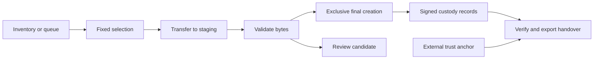

# TOD-DL

[Repository](https://github.com/KUSH42/tod-dl-docs) / Documentation

![TOD-DL: Acquire. Preserve. Verify. Signal design banner][banner]

**Bounded native acquisition with durable recovery and signed provenance.**

TOD-DL acquires a bounded set of files from unreliable sources, including
Tor onion services. It preserves existing final files, resumes interrupted
transfers, and records signed provenance that an independent verifier can
check. The name stands for *Tor Onion Dump Downloader*.

[Project brief][brief] · [Documentation][docs] · [Operator guide][operate] ·
[Architecture][architecture] · [Specifications][specs]

This public repository presents the project through engineering guides,
visual demonstrations, and selected specification artifacts. The source code
and complete specification set remain private. The material here explains
project design and scope; it does not provide an installable downloader.

## Native engine cutover

Acquisition URL queues use the native transfer engine. `--engine native` selects
the same engine explicitly. The controller writes received bytes to staging and
records authenticated range receipts. Descriptor acquisition remains blocked
in the public CLI.

A continuation requires a checkpoint-authenticated prefix, a successful
reread, and either a strong ETag or a trusted expected checksum. Weak or
missing ETags alone do not protect resume. The controller checks the response
head before appending bytes. A rejected continuation preserves the prefix
and enters review. Recovery preserves unsigned suffix bytes before installing
the authenticated prefix.

Reuse the run ID, queue inputs, and `--max-files` value when resuming.
An acquisition retry keeps the staging generation and immutable selected set.
After storage or signing repair, confirmed `resume_admission` completes
recovery before restarting writers.

Native transport failures include a fixed `diagnostic` code for operator
diagnosis. The timeout and telemetry contract in [the native engine
specification](../specs/SPEC-native-transfer-engine.md) defines the diagnostic
behavior. A code does not establish the cause of an earlier failed attempt.

The downloader rejects `--engine aria2`, `--aria2c`, `--aria2-rpc`,
`--no-aria2-rpc`, and `--rpc-eval` with exit status 2. Archived aria2 runs
require their matching working copy for resume. Use the matching archived
build to verify a non-active version 2 schema. Keep earlier evidence unchanged.

Fresh native Tor acquisitions passed signed-record and final-file
verification. The [source evidence and handover][native-evidence] record
the scope. Interrupted source resume and the complete acceptance matrix
remain unverified. Focused tests do not establish cutover acceptance. The
[cutover contract][cutover] defines resume, removal, compatibility, and
acceptance requirements. The [open-work register][open-work] lists remaining
work.

The [operator guide][operate] documents native acquisition and protected
resume. The [architecture guide][architecture] maps native workers, prefix
recovery, and authenticated receipt coverage.

## Worker limits

`--workers` sets the startup limit. The default worker mode is `fixed`.
Use `--worker-mode auto` to start at the minimum and adjust within the startup
`--workers` ceiling. Automatic adjustment uses observed payload and congestion
over feedback windows; missing samples or admission holds keep the limit.
It does not guarantee higher throughput.

In `monitor.py --control`, use **Worker limit** or **Worker mode** on the
Activity tab. Each button opens its own input and confirmation. A manual
limit change switches to fixed mode. Lowering the limit lets outstanding
tasks finish; raising it admits work through the existing acquisition gates.
Read-only monitoring displays the setting and disables both controls.

Live settings belong to the current controller session. On restart, CLI
settings initialize the limit again. Resume scripts retain their startup
values. [The worker-limit contract](../specs/SPEC-dynamic-worker-limits.md)
defines the policy and verification requirements.

## Automatic parallel ranges

Use `--parallel-ranges auto` to enable bounded parallel requests for eligible
native URL-queue files. The default is `off`. Eligibility requires a known
large identity-coded representation and a strong ETag. The policy and defaults
are owned by [the parallel-range contract][parallel-ranges].

Set `--ranges-per-file` and `--connection-limit` to control per-file and global
request concurrency. Both values must be positive integers. Worker-limit
changes retain these independent connection settings. A limit of one keeps
acquisition sequential. The monitor shows active segments in the item row.

Private segments stay below the case state directory. The controller verifies
and signs each completed segment, then assembles contiguous staging receipts.
A restart with ranges off retains authenticated segments and fills earlier
bounded gaps before continuing sequentially. Keep the same run ID and selected
queue inputs. Resume scripts record all three startup settings explicitly.

Parallel acquisition uses the active schema's distinct segment receipt
profile. Earlier schema pins fail closed. Auto mode also refuses an active
run pinned to the sequential receipt profile. Do not rewrite retained pins.
The new schema retains earlier bytes and a signed synthetic fixture for
verification with their matching build.

Focused fixture checks do not establish Tor acceptance or operator-pilot
completion. The [implementation report][parallel-report] records verified
checks and remaining acceptance work. No throughput guarantee
follows from enabling parallel requests.

## Non-forensic downloads

Use `--run-mode download` for unsigned URL-queue downloads. The default remains
`--run-mode acquisition`. Download mode needs no signing key or custody inputs.
It rejects acquisition-only options and request descriptors before startup
writes or requests. The
[non-forensic contract](../specs/SPEC-non-forensic-downloads.md)
defines the boundaries.

Use separate case paths outside the source repository:

```bash
python3 src/tod_dl.py \
  --run-mode download \
  --queue /case/queues/priority.txt \
  --destination /case/downloaded_files \
  --state /case/unsigned-state \
  --run-id unsigned-run \
  --max-files 20
```

The destination and state must share a filesystem. The queue route, Tor
isolation, TLS checks, storage reserve, and connection limits still apply.
Every existing final is protected, including files from signed runs. A
collision retains unsigned staging and fails the item.

Startup, the console, the operational log, and the closing summary identify
`NON-FORENSIC / NO SIGNED PROVENANCE`. Local file digests and checksum matches
do not establish source authenticity or custody. The provenance verifier
refuses unsigned state. Operational format and version belong to
`src/downloader/download_state.py`; warning text belongs to
`src/downloader/download_mode.py`.

To split files without strong ETags, select both `--parallel-ranges auto` and
`--ignore-etag`. The override is available only in download mode. It omits
`If-Match` and ETag comparisons. Range, length, framing, coding, checksum, and
path checks remain active. The size threshold and segment size retain their
[parallel-range owner][parallel-ranges]. The console shows
`ETAG CHECKS DISABLED`. Without a trusted expected checksum, equal-length
segments from different file versions can complete undetected.

Retries and interrupted items start from zero in a new unsigned generation.
Old generation directories retain their bytes for inspection. An ignored
range response can consume one retry and select sequential transfer for the
item. Completed items are skipped only after local size and digest checks.
Resume with the same mode, ETag override, run ID, queue inputs, selected-set
limit, destination, and attempt ceiling. The generated resume script retains
those settings. Changing modes requires new state and a new run ID.

The [implementation report](../specs/reports/non-forensic-downloads-2026-10-03.md)
records synthetic fixture checks. Complete route, resource, and lifecycle
acceptance remains open. CI must run the full suite. Native cutover acceptance
and the operator pilot remain unverified.

## Choose your path

Start with the depth that fits your goal.

| You want to… | Start here |
| --- | --- |
| Understand the project in a few minutes | [Project brief][brief] |
| Evaluate the engineering | [Design decisions][decisions] |
| Prepare an acquisition | [Operator guide][operate] |
| Read or change the code | [Architecture][architecture] · [Develop][develop] |
| Assess trust | [Audit rail][audit] · [Custody][custody] |
| Explore contracts and validation reports | [Specification guide][specs] |

## The engineering problem

A successful HTTP response does not finish an acquisition. The controller
must also handle a changed remote file, a full disk, a process crash, and an
existing destination. A reviewer then needs to distinguish retained bytes,
recorded observations, and verified claims.

TOD-DL makes those decisions explicit:

- **Bounded scope.** Queue hashes and selection settings bind a run to its
  selected items. A retry cannot silently expand the acquisition.
- **Durable recovery.** SQLite stores state transitions and promotion intent.
  Recovery reconciles interrupted work with the filesystem.
- **Evidence preservation.** Exclusive file creation protects existing
  finals. Conflicts retain incoming bytes for review.
- **Verifiable history.** Signed checkpoints and run indexes connect
  sessions, outcomes, retained inputs, and final-file digests.
- **Separate observation and control.** A Textual console reads published
  telemetry. Confirmed commands reach the controller through a local socket.
- **Independent review.** Read-only verification checks a run or handover
  against a trusted public key and an externally retained index digest.

The [architecture guide][architecture] connects these choices to source code
and tests. The [custody guide][custody] follows the acquired bytes.

## See the console

The recorded demo shows the monitor and controller interface. Use it as a
visual introduction; current controls are documented in the operator guide.

![Recorded TOD-DL monitor and controller demonstration][demo]

## From selected input to verified handover

The acquisition controller owns state changes. Verification uses retained
artifacts and external trust material.



The [audit guide][audit] explains signed checkpoints, run completeness,
optional external timestamps, and the limits of each claim.

## Current scope

TOD-DL is a portfolio project under active development. It is not
production-ready or fully specification-complete. The
[open-work register][open-work] tracks remaining validation and
implementation work.

**Available paths** include bounded URL-queue acquisition, resume, live
worker limits, automatic parallel ranges, unsigned download mode, inventory
manifests and diffs, console controls, version 2 custody records, handover
export, and optional external timestamping. Each feature has a linked
contract in the [specification guide][specs].

**Descriptor acquisition remains blocked in the public CLI.** Descriptor
validation, transport adapters, and sealed request evidence have implemented
components and local tests. Those components do not imply a released
acquisition path. Controller startup uses a separate rollout refusal before
runtime writes; its gated dispatch uses item-keyed descriptor sessions. See
the [transport release gate][transport].

HTTP onion descriptors require the `forensic-body-integrity` assurance
profile and a Tor-only source policy. Validate an operator-provided, bounded
selection without source contact:

```bash
python3 src/tod_dl.py \
    --artifact-root /case/inputs \
    --source-policy /case/inputs/source-policy.json \
    --queue /case/inputs/requests.jsonl \
    --assurance-profile body-profile.json \
    --destination /case/downloaded_files \
    --state /case/runs/http-001 \
    --run-id http-001 --max-files 3 --dry-run
```

Keep the profile below `/case/inputs`. Its required artifact values are owned
by [response-body integrity](../specs/SPEC-response-body-integrity.md).
For a `ca_bundle` policy with any HTTPS origin, add `--tls-ca-bundle FILE`.
The bundle must match the policy digest. An HTTP-only policy needs no runtime
bundle. Reuse the run ID, queue, policy, profile, and `--max-files` on resume.
Queries select request data; `resource_key` owns identity and
`logical_relative_path` owns the destination.

The read-only run verifier checks signed body-hop origins against retained
policy inputs when you pass `--artifact-root`. An authorized operator can add
`--sealed-evidence-private-key FILE` with `--sealed-evidence-dir DIR` to
decrypt referenced format-2 or format-3 sidecars and compare each request's
method, number, sanitized URL, headers, and signed origin. The private key must
be an X25519 PEM key. Pass `--artifact-root` to check retained descriptors and
rebuild their secret-value redaction filters from decrypted requests. The
verifier checks payload fields and entry counts. Public verification cannot
establish a redacted path or query. For an abandoned sealed attempt, the
verifier checks the retained sidecar in the interrupted session first. If no
retained sidecar exists, the verifier checks the recovering session's sidecar.
A corrupt retained sidecar fails verification. After successful decryption,
authorized verification reports `source_contact_unknown` for abandonment.
Sealed entries prove preparation; source contact remains unknown. Neither
verifier changes evidence files.

Body-profile retries use the authenticated generation sequence owned by
[body integrity](../specs/SPEC-response-body-integrity.md#descriptor-items).
The run verifier checks this sequence without requiring a control decision
for an automatic retry, including after abandonment.

The controller authenticates the configured format and recipients before
creating the sidecar envelope. If envelope creation crashes, recovery retains
an existing envelope or creates a durable empty envelope before abandonment.
Recovery still refuses a pending attempt without an authenticated start.
The [creation-crash report](../specs/reports/sealed-creation-crash-2026-10-02.md)
records the local T11 checks. Public descriptor acquisition remains blocked.

**Validation results have a date and a scope.** The [project brief][evidence]
links the engine evaluation, transport matrix, and timestamp acceptance
reports. Historical results do not certify the current checkout.

## Start locally

Use Python 3 to create the downloader environment from the repository root.
Tor routes also require `torsocks` and a local Tor service with
`IsolateSOCKSAuth`. The native engine does not require `aria2c`.
Keep the case directory outside the source repository. The destination and
state directories must use the same filesystem.

Install the pinned downloader dependencies:

```bash
python3 -m venv .venv
. .venv/bin/activate
python3 -m pip install -r requirements-downloader.txt
```

With an operator-provided queue outside the repository, inspect a bounded
selection without starting a transfer:

```bash
python3 src/tod_dl.py \
    --queue /case/urls_priority.txt \
    --destination /case/downloaded_files \
    --state /case/runs/run-001 \
    --dry-run --max-files 3
```

Replace `/case` with your case directory. Review the reported final paths.
For descriptor queues, `--dry-run` checks the configured sealed-evidence
recipient keys. On resume, the check authenticates recorded sealed starts
with the run's signing key and rejects changed formats or recipient sets.
Use the same `--run-id`, `--state`, and `--provenance-signing-key` as the run.
The check writes no durable acquisition state. SQLite can create shared-memory
lock metadata and an empty write-ahead log during read-only access.
A live native run requires `--provenance-signing-key`. Keep signing keys and
trusted public keys outside the repository. The [operator guide][operate]
covers context declarations, control, and verification. Apply the native
compatibility and resume rules in the [cutover contract][cutover].

For a native URL queue, `route=proxy:NAME` selects a named HTTP proxy.
Pass `--proxy-config FILE` with the proxy table defined by the
[HTTP transport contract][transport]. URL queues do not require
`--source-policy`. Keep proxy credentials in the configured environment
variable, outside queue files and the repository.

## Develop and check changes

Use focused tests for the behavior you change. Native transfer and recovery
checks include:

```bash
python3 -m unittest tests.test_native_controller tests.test_native_ranges
python3 -m unittest tests.test_native_recovery tests.test_native_cutover
python3 -m unittest tests.test_archived_engine_retention
python3 -m compileall -q src
bash -n ./run.sh
git diff --check
```

Include affected lifecycle, schema, finalization, and session-order tests.
Tests use synthetic inputs and temporary paths. Transport tests use loopback
fixtures; do not contact a source to validate a code change.

CI measures Python line and branch coverage for the unittest process.
Child processes are unmeasured. Download the `python-coverage` artifact from
the workflow run and open `html/index.html` after extraction. Failed tests
produce partial coverage. See the
[coverage specification](../specs/SPEC-ci-python-coverage.md) for the contract.

CI runs the full suite. Run the full suite locally only when explicitly
requested. Report skipped checks and environment restrictions. The repository
rules in [AGENTS.md](../AGENTS.md) define the testing policy; the
[development guide][develop] provides additional examples.

## Repository map

The source tree contains software, synthetic fixtures, specifications, and
validation reports. Keep acquired data, queues, state, and secrets in a
separate case directory.

| Path | Responsibility |
| --- | --- |
| [`src/downloader/`][ref-1] | Acquisition and recovery |
| [`src/console/`](../src/console/) | Textual monitor and review views |
| [`src/ipc/`](../src/ipc/) | Telemetry, inspection, and local control endpoints |
| [`src/provenance/`][ref-2] | Records, verification, and export |
| [`src/inventory.py`][ref-3] | Manifests, diffs, and queues |
| [`src/evaluation/`](../src/evaluation/) | Local acquisition-engine evaluation |
| [`tests/`](../tests/) | Behavior checks and synthetic fixtures |
| [`docs/`](README.md) | Reader guides and engineering explanations |
| [`specs/`](../specs/INDEX.md) | Behavior contracts and dated reports |

## License and use

Use TOD-DL only for material you are authorized to acquire and retain.
The [TOD-DL Non-Commercial License](LICENSE) permits personal, educational,
and portfolio-review use. Commercial use and redistribution need prior
written permission from the copyright holder.

## View the demonstrations

The visual demonstrations use synthetic content. They illustrate the design
and do not establish source authenticity or acquisition acceptance.

![Synthetic points form a file and linked provenance records.][motion]

The public repository contains **five specifications**, rather than the
complete private set. It presents the document design, linked contents,
rendered diagrams, and PDF navigation.

- [Download the five-specification PDF][demo-pdf].
- [Download the companion HTML][demo-html] and open it in a browser.
- [View the project presentation HTML][presentation] by downloading the file
  and opening it in a browser.

## Current scope and evidence

TOD-DL remains a portfolio project under active development. URL queues use
the native transfer engine. Protected continuation requires authenticated,
reread prefix bytes and a strong ETag or trusted expected checksum. Weak or
missing ETags alone cannot protect continuation.

The operator guide records successful fresh Tor acquisitions with signed
record and final-file verification. Interrupted source resume, the complete
native acceptance matrix, and the operator pilot remain unverified.
Descriptor acquisition remains blocked in the public CLI.

Specifications define behavior contracts. Their status lines distinguish
implemented behavior from planned work. Dated reports establish evidence
for their stated scope; historical results do not certify a current build.
The [project brief][brief] explains validation evidence and project limits.
The public demo does not publish the complete acceptance evidence.

## About this repository

This repository contains public documentation and presentation artifacts.
The [operator guide][operate] explains workflows for the separate downloader.
The [development guide][develop] describes work in the private source
repository. Commands and source paths in those guides require that checkout.

The artifact builder in the private source repository supports full and
limited document builds. From that checkout's root, run
`node .github/scripts/build-html-pdf.js --max-specs 5` to select up to five
specifications in filename order. Omit `--max-specs` to include the full set.
The builder defaults to `specs/` and `build/artifacts/`, regardless of the
working directory. It writes `output_<design>.html` and
`combined_output_<design>.pdf`. Signal is the default design, selected by
`DESIGN` in `.github/scripts/build-html-pdf.js`. Use `--design` to select
another design. A build requires the private specification inputs and the
dependencies in `.github/scripts/package.json`. Generated files in `build/`
are ignored by Git. The published five-spec demo linked above is a separate
artifact and uses the Signal design.

Start with the [project brief][brief], then follow the guide for the
engineering question you want to review.

[banner]: assets/tod-dl-banner-animated.gif
[demo]: ../monitor-controller-demo.gif
[brief]: PORTFOLIO-OVERVIEW.md
[docs]: README.md
[operate]: OPERATOR-GUIDE.md
[architecture]: ARCHITECTURE.md
[decisions]: PORTFOLIO-OVERVIEW.md#engineering-decisions
[develop]: DEVELOPMENT.md
[audit]: AUDIT-RAIL.md
[custody]: CHAIN-OF-CUSTODY.md
[specs]: SPECIFICATIONS.md
[open-work]: OPEN-WORK.md
[transport]: ../specs/SPEC-http-transport.md
[cutover]: ../specs/SPEC-native-engine-cutover.md
[evidence]: PORTFOLIO-OVERVIEW.md#validation-evidence

[ref-1]: ../src/downloader/
[ref-2]: ../src/provenance/
[ref-3]: ../src/inventory.py

[native-evidence]:
  ../specs/reports/native-acquisition-handover-2026-10-01.md

[parallel-ranges]: ../specs/SPEC-automatic-parallel-ranges.md
[parallel-report]: ../specs/reports/automatic-parallel-ranges-2026-10-03.md

[identity]: VISUAL-IDENTITY.md
[motion]: assets/acquisition-motion.gif
[motion-page]: assets/acquisition-motion-signal.html
[motion-still]: assets/acquisition-motion.png
[demo-pdf]: tod-dl-tech-specs.pdf
[demo-html]: tod-dl-tech-specs.html
[presentation]: tod-dl-web.html
